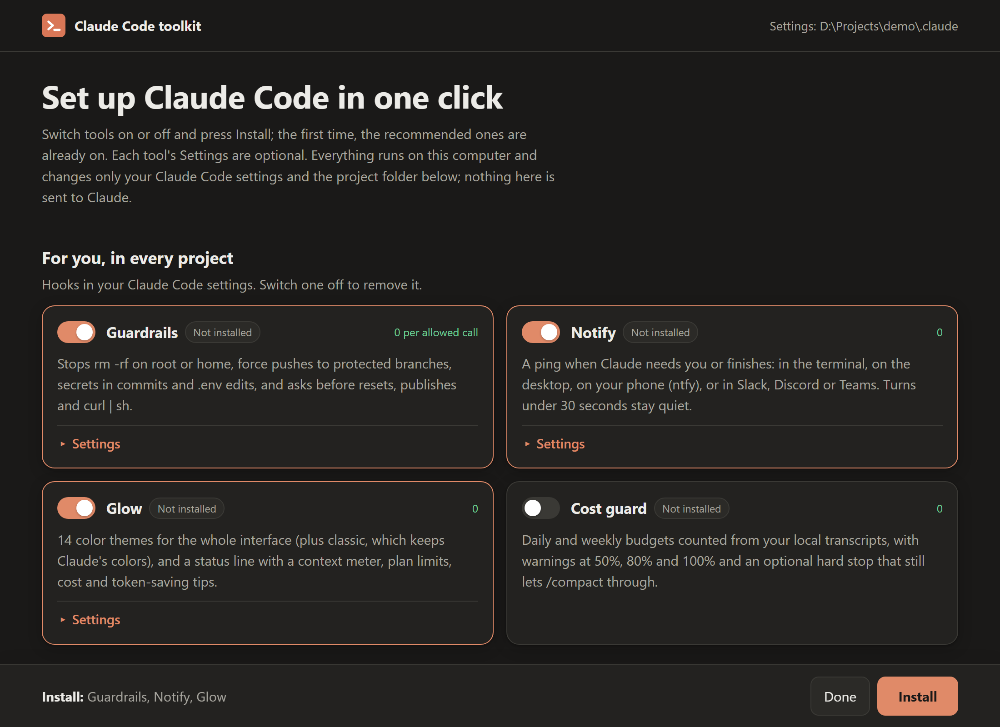

# Claude Code toolkit

[](https://github.com/nrzz/claude-code-toolkit/actions/workflows/e2e.yml) [](https://github.com/nrzz/claude-code-toolkit/actions/workflows/test.yml) [](LICENSE)  

Fifteen small, open-source tools that make Claude Code cheaper, safer and easier to share. Each one is a dependency-free Node command or plugin that adds few or no tokens to your sessions, and all fifteen are tested together, installed from GitHub, on Windows, macOS and Linux.

Website: [nrzz.github.io/claude-code-toolkit](https://nrzz.github.io/claude-code-toolkit/)

## Set up in one click

```bash
npx -y github:nrzz/claude-code-toolkit
```

That opens a setup page in your browser. The first time, the recommended tools (guardrails, notify and glow) are already switched on, so pressing **Install** is the whole setup. Each tool's **Settings** hold the few choices that need you: the glow theme (shown with its colors), the guardrails preset, where notify reaches you (desktop, phone, Slack, Discord or Teams), cost guard's budgets and, for the project you ran it in, the handover files, team sync's hub and a starter kit you can preview before it writes anything. Run it again any time to change a setting or switch a tool off; it shows what is installed and how it is set.



The page is served by the command itself on 127.0.0.1, with a one-time key in its link, and only runs each tool's own installer, which backs up `settings.json` first. It stops when you press **Done**. Where no browser can open (over SSH, in a container) it asks the same questions in the terminal, and for scripts there is no question at all:

```bash
npx -y github:nrzz/claude-code-toolkit install recommended --theme nord --daily 20usd
```

`status` shows what is installed, `uninstall all` takes out what the tools added to your Claude Code settings (handover keeps your project notes and the effort defaults it set, and says so), and `--help` lists every option. Nothing here runs Claude, so setting up costs no tokens.

## Pick what you need

| You want to | Use | What it adds to a session |
| --- | --- | --- |
| Stop paying to reload one giant chat | [claude-code-handover](https://github.com/nrzz/claude-code-handover) | About 700 tokens when new (your rules, the handover file and the latest decisions; the handover stays under 120 lines), and 110 to 200 more on a prompt that matches an earlier session |
| Share sessions, notes and context with coworkers | [claude-code-team-sync](https://github.com/nrzz/claude-code-team-sync) | 0 when nothing is new, at most about 375 tokens when a teammate shared something |
| Theme the whole interface and watch your context, limits and cost | [claude-code-glow](https://github.com/nrzz/claude-code-glow) | 0 |
| Stop `rm -rf /`, force pushes, secrets in commits and `.env` edits | [claude-code-guardrails](https://github.com/nrzz/claude-code-guardrails) | 0 for every allowed call, about 45 tokens for a denied one |
| Look away while Claude works, and get a ping when it needs you | [claude-code-notify](https://github.com/nrzz/claude-code-notify) | 0 |
| Keep spending inside a daily or weekly budget | [claude-cost-guard](https://github.com/nrzz/claude-cost-guard) | 0 |
| See what your CLAUDE.md costs in every session, and slim it | [claude-md-doctor](https://github.com/nrzz/claude-md-doctor) | 0: it runs outside Claude |
| Start a project with a lean, safe `.claude/` for your stack | [claude-code-starter-kits](https://github.com/nrzz/claude-code-starter-kits) | The CLAUDE.md it writes: 230 to 260 tokens |
| Find a past discussion, or share a session as a web page | [claude-session-replay](https://github.com/nrzz/claude-session-replay) | 0: it runs outside Claude |
| Continue a Cursor or Antigravity chat in Claude Code, or hand a session to them | [claude-chat-ferry](https://github.com/nrzz/claude-chat-ferry) | 0: it runs outside Claude |
| Delete, keep and restore your sessions before the 30-day cleanup removes them | [claude-session-tidy](https://github.com/nrzz/claude-session-tidy) | 0: it runs outside Claude; the optional skill costs about 1,400 tokens per use |
| See why a permission prompt appeared, drop dead rules and add the ones you keep approving by hand | [claude-permission-doctor](https://github.com/nrzz/claude-permission-doctor) | 0: it runs outside Claude; the optional skill costs about 850 tokens per use |
| Run every hook with the JSON Claude Code sends, and see what each one does | [claude-hook-bench](https://github.com/nrzz/claude-hook-bench) | 0: it runs outside Claude; the optional skill costs about 500 to 900 tokens per use |
| Move Claude Code's config folder to another drive, or into the XDG folders, and keep every shell pointed at it | [claude-relocate](https://github.com/nrzz/claude-relocate) | 0: it runs outside Claude |
| Comment your settings, see what Claude Code merges and from which file, and find the mistakes it ignores in silence | [claude-settings-doctor](https://github.com/nrzz/claude-settings-doctor) | 0: it runs outside Claude; the optional skill costs about 340 tokens per use |

Every tool's README has a "What it costs in tokens" table with the details, and a "What was verified, and how" section that says what was checked and what was not.

## Other ways to install

### The plugins, from one marketplace

Spendcap (cost guard) is in Anthropic's plugin directory since 14 October 2026, so it installs with nothing to add first: `/plugin install spendcap@anthropic-plugin-directory`, and `/plugin`, Discover, lists it. For all twelve, add this marketplace. If you prefer Claude Code's own plugin system, in Claude Code:

```text
/plugin marketplace add nrzz/claude-code-toolkit
/plugin install guardrails@claude-code-toolkit
```

Then install any of the others the same way, or browse them with `/plugin`:

| Plugin | Install |
| --- | --- |
| Glow: themes and status line | `/plugin install glowline@claude-code-toolkit` |
| Glow HUD (early access) | `/plugin install glowbar@claude-code-toolkit` |
| Guardrails | `/plugin install guardrails@claude-code-toolkit` |
| Notify | `/plugin install nudge@claude-code-toolkit` |
| Cost guard | `/plugin install spendcap@claude-code-toolkit` |
| CLAUDE.md doctor | `/plugin install md-doctor@claude-code-toolkit` |
| Session replay | `/plugin install replayer@claude-code-toolkit` |
| Chat ferry | `/plugin install chat-ferry@claude-code-toolkit` |
| Session tidy | `/plugin install session-tidy@claude-code-toolkit` |
| Permission doctor | `/plugin install permission-doctor@claude-code-toolkit` |
| Hook bench | `/plugin install hook-bench@claude-code-toolkit` |
| Settings doctor | `/plugin install settings-doctor@claude-code-toolkit` |

Five plugins were renamed on 4 October 2026 so that each has a name of its own in Anthropic's plugin directory: `glow` is now `glowline`, `glow-hud` is `glowbar`, `notify` is `nudge`, `cost-guard` is `spendcap` and `replay` is `replayer`. If you installed one under its old name, uninstall it and install the new one; the tools, their commands and your settings are unchanged.

By Claude Code's own estimate (`claude plugin details`), all twelve together add about 191 always-on tokens, and only because the estimate counts the descriptions of user-only skills, which Claude Code leaves out of the list it gives the model. The end-to-end test keeps that estimate under 200 always-on tokens. The limit was 150 until the tenth plugin: a new tool's user-only skill adds 11 to 17 to the estimate (session tidy's 15, permission doctor's 17, hook bench's 15, settings doctor's 11; the nine before added 148), and cutting a description until it fits would only make it harder to read, to save text the model is never sent. What the test also checks is the request itself: with all twelve plugins installed it has Claude Code resume a session against a fake API on localhost, and no request that reaches the fake API may mention any user-only skill, while a skill the model may invoke is listed in it.

### One tool at a time

Each tool also runs straight from GitHub with `npx`, nothing to install first:

```bash
npx -y github:nrzz/claude-code-handover init
```

```bash
npx -y github:nrzz/claude-code-team-sync init
```

```bash
npx -y github:nrzz/claude-code-starter-kits
```

```bash
npx -y github:nrzz/claude-md-doctor
```

```bash
npx -y github:nrzz/claude-session-replay list
```

```bash
npx -y github:nrzz/claude-chat-ferry import cursor:latest
```

```bash
npx -y github:nrzz/claude-session-tidy list
```

```bash
npx -y github:nrzz/claude-permission-doctor lint
```

```bash
npx -y github:nrzz/claude-hook-bench run
```

```bash
npx -y github:nrzz/claude-relocate plan
```

```bash
npx -y github:nrzz/claude-settings-doctor lint
```

```bash
npx -y github:nrzz/claude-code-glow install
```

Guardrails, notify, cost guard and session tidy have the same `init`; handover's and team sync's run in the project folder. Every tool that changes your Claude Code settings has an `uninstall` that takes out what it added; team sync and the starter kits write files into the project, which you commit or delete like any other. Permission doctor installs nothing: it writes a settings file only when you ask it to (`lint --fix`, `suggest --write`), after a backup that `restore` puts back. Hook bench installs nothing either, and never writes a settings file: it runs your hooks and reports. Relocate changes nothing without `--yes`, and its `undo` puts the folder back where it was. Settings doctor writes a settings file only with `init`, `build`, `absorb`, `watch` and `restore`, after a backup that `restore` puts back.

## Built the same way

- **No dependencies.** Node 18 or newer and nothing from npm, so there is nothing to audit but the code itself.
- **Token cost is a feature.** A hook puts text in front of the model only when that is its job (a recalled line, a teammate's news, the reason a command was stopped), and the README says how much. Everything else talks to you, not to the model. Skills that Claude does not need to see are user-only.
- **Your settings stay yours.** Each tool backs up `settings.json` before writing, changes only the keys it is there for, leaves a file that is not valid JSON alone, and its `uninstall` takes out what it added (handover keeps the effort defaults it set, and says so).
- **Tested.** Over 6,500 automated tests across the fifteen repositories, each run on Windows, macOS and Linux with Node 20, 22 and 24, and on Linux with Node 18, plus the end-to-end run below.

## Tested together

[`e2e/run.mjs`](e2e/run.mjs) does what a new user would, on a clean machine:

1. It makes a throwaway home folder and Claude Code config folder that already hold settings of their own (a theme, an env variable, a permission, a Stop hook).
2. It installs every tool from GitHub with `npx` and runs every hook exactly as `settings.json` lists it, with the JSON Claude Code sends: guardrails denies `rm -rf /` and passes `npm test` in silence, notify stays quiet after a 5-second turn and pings after a 60-second one, cost guard holds a prompt over a hard budget but lets `/compact` through, the starter kit's CLAUDE.md passes the doctor in CI mode, two teammates share a session through one git remote, a replay export escapes hostile text, session tidy keeps one old session and moves another to its trash and back byte for byte, permission doctor explains a prompt, finds a dead rule and proposes a rule from a transcript without changing a file, hook bench runs a settings file's hooks with the JSON Claude Code sends and calls the deny a deny, the invalid output an error and the typo a hook that never fires, relocate moves a config folder with its sessions to another folder and puts it back byte for byte, settings doctor finds the trailing comma that makes Claude Code ignore a whole file, an unknown key and a wrong type, and builds `settings.json` from a commented `settings.jsonc`, and handover's self-test passes and its `init` sets up a project, changes nothing on a second run and uninstalls cleanly.
3. In a second home folder it runs the one-command setup as a user would: `install recommended,cost-guard` with options, a guardrails hook it installed denying `rm -rf /`, `status` reading the choices back, then the setup page started for real and driven through its own API (the one-time key refused when missing, Apply changing a theme and removing a tool, Done stopping it), and `uninstall all`.
4. With a Claude Code CLI available, it validates this marketplace, installs all twelve plugins from GitHub with `claude plugin install`, runs the guardrails, notify, cost guard and session tidy plugins' own hooks and the permission doctor, hook bench and settings doctor plugins' skill commands from the installed copies, checks the token estimate and that Claude Code sends the model none of their user-only skills, and runs the HUD's engine tests inside that Claude Code.
5. It uninstalls everything and checks that `settings.json` is exactly what the user had, in both home folders.

```bash
node e2e/run.mjs
```

`--local` uses sibling checkouts instead of GitHub, `--only setup,glow` runs a few, and `E2E_CLAUDE=<path to claude>` points at the CLI for step 4. CI runs it on every push and every week on Windows, macOS and Linux, so a change in Claude Code that breaks a tool shows up here.

## Contributing

Every tool welcomes issues and pull requests: each repository has a CONTRIBUTING.md and issue templates, and there are issues labelled [good first issue](https://github.com/search?q=user%3Anrzz+label%3A%22good+first+issue%22+state%3Aopen&type=issues) and [help wanted](https://github.com/search?q=user%3Anrzz+label%3A%22help+wanted%22+state%3Aopen&type=issues) to start with. For the marketplace, the website or the end-to-end test, see [CONTRIBUTING.md](CONTRIBUTING.md). Questions and ideas for new tools go to [Discussions](https://github.com/nrzz/claude-code-toolkit/discussions).

## Stay in the loop

If a tool here saves you tokens, a star on this repository helps other people find it. New tools and releases are announced in [Discussions](https://github.com/nrzz/claude-code-toolkit/discussions), and following [@nrzz](https://github.com/nrzz) on GitHub shows them in your feed.

## License

MIT
